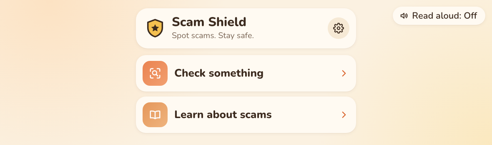
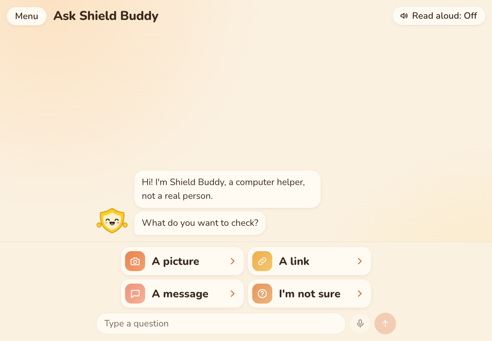
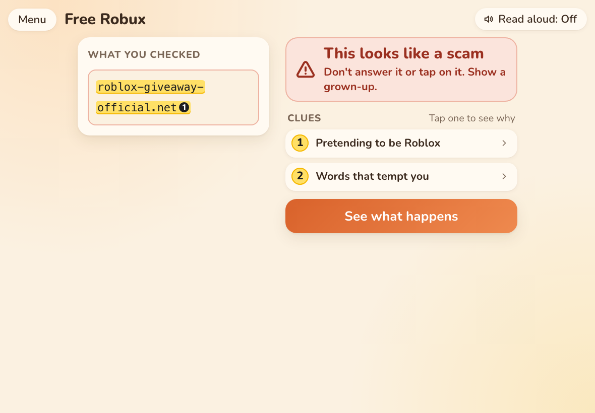
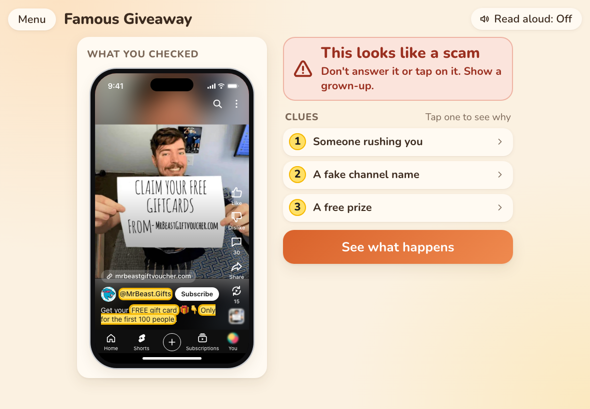
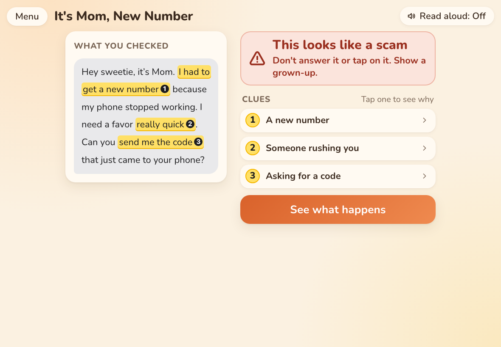
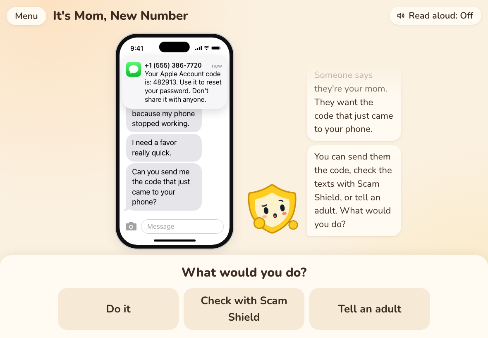
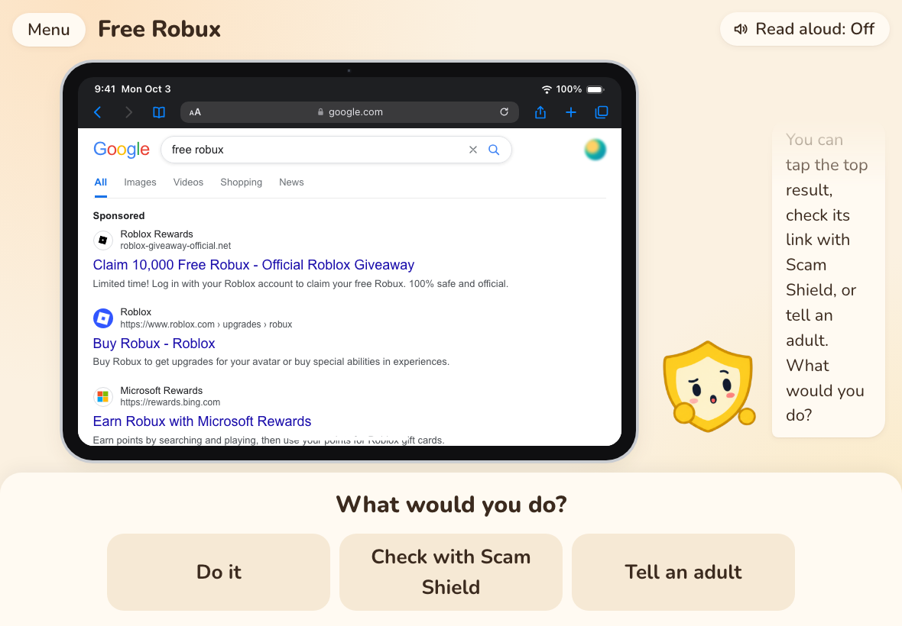
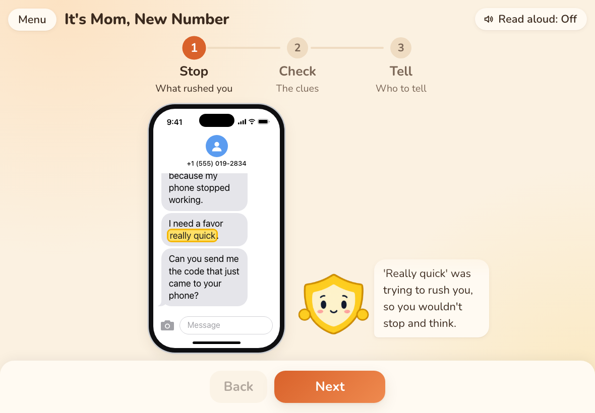
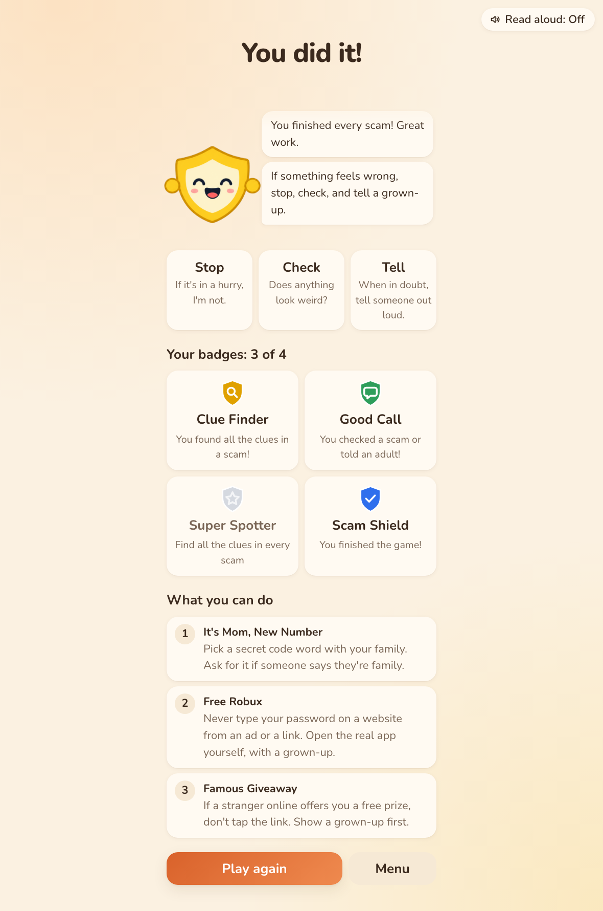
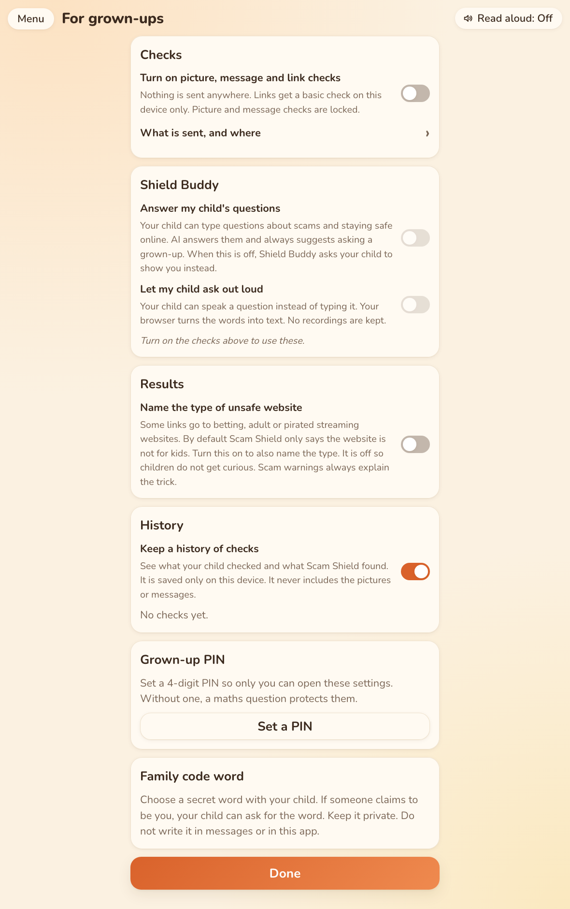

# Scam Shield: Stop, Check, Tell

**Play it: [lukeyeh4.github.io/scam-shield](https://lukeyeh4.github.io/scam-shield/)**

An app that helps kids aged 8–12 spot scams. It has two parts:

- **Check something:** when a text, link, picture or website feels weird, kids check it with Shield Buddy and see the clues in kid words, with what to do next.
- **Learn about scams:** a game where each scam looks like the real thing (a text from "Mom", a Google search, a YouTube Short). Kids pick what to do, see what happens, then learn the clues with **Stop, Check, Tell**.



**The key lesson:** don't do what the scam asks. Check it with Scam Shield, and show a grown-up.

## Contents

- [Stop, Check, Tell](#stop-check-tell)
- [Check something](#check-something): [a link](#check-a-link), [a picture](#check-a-picture), [a message](#check-a-message)
- [Learn about scams](#learn-about-scams): [how it plays](#how-it-plays), [the scams](#the-scams)
- [Shield Buddy](#shield-buddy)
- [For grown-ups](#for-grown-ups)
- [Design](#design)
- [Getting started](#getting-started) and [how it's built](#how-its-built)
- [Open questions](#open-questions)

## Stop, Check, Tell

| | | In kid words |
|---|---|---|
| **Stop** | Scammers want you to rush. Slow down. | "If it's in a hurry, I'm not." |
| **Check** | Look for clues that something is wrong. | "Does anything look weird?" |
| **Tell** | Show a trusted adult before doing anything. | "When in doubt, tell someone out loud." |

## Check something

<table>
  <tr>
    <td width="50%"></td>
    <td width="50%"></td>
  </tr>
  <tr>
    <td><b>Ask Shield Buddy.</b> Buddy asks what it is and opens the right checker. Kids can also type or say a question.</td>
    <td><b>The result.</b> What was checked, with each clue marked and numbered, what to do, and the clues in a short list. Tap one to see why.</td>
  </tr>
</table>

Every result works the same way:

- **A risk level, never "safe":** soft red ("This looks like a scam"), yellow ("Be careful") or green ("No clues found", with good signs), with what to do right under the heading. It always ends with "show a grown-up".
- **Clues in kid words:** tap a clue for a one-line reason, then "Why? Ask Shield Buddy": Buddy points to where to look, explains why in two short lines, and gives a "Next time..." tip with a grown-up.
- **The AI never writes what kids read.** It only answers fixed questions; the app's own scripted words are shown. Kids are told the checks use AI: Buddy says it's "a computer helper, not a real person", and every AI result says so.
- **Help when it's serious:** a threat, a request for photos, or a picture Claude won't look at gets a calm "Show a grown-up right now / It's not your fault" with three steps (the picture is blurred if it may not be OK to see). "Ask Buddy about this" helps kids who already tapped, replied or sent something.

### Check a link

Kids paste a link (or a whole message with a link in it), and each clue is marked in the link and explained: what the trick is, and what the real website looks like. Betting, adult and pirated streaming websites are red too, headed "This website isn't for kids", and by default only say that, not what's there (a grown-up can turn on "Name the type of unsafe website").

It checks in three layers, and never opens the link on the kid's device:

1. **The address, on the device (instant):** the real website is found with the Public Suffix List; then it looks for brand copies (rob1ox, ronlox, letters from other alphabets, roblox.com.evil.net), a real address hidden after an @ or in the path, free website makers, short links, cheap endings, tempting words and http. Fan websites of games get a gentler clue than copies of accounts and money services like PayPal. Known betting and adult websites, and adult or betting words in a website's name, are caught here too, so they're flagged even before a grown-up finishes setup.
2. **Facts from our small server** (a Cloudflare Worker): Google Safe Browsing, Cloudflare's free DNS filters (dangerous websites, and adult ones), how new the website is, whether it exists, and where a short link really goes (that address gets every check too).
3. **Claude reads the page** (Claude Haiku 5.5), only when nothing strong was found: fixed yes/no questions, like "Does it copy a brand?", "Does it ask for a password?", "Free prizes?", "Free paid sports or shows?", "Pop-up ads?", "Betting?", "Adult, or an 18+ age gate?". When the page can't be read (bot protection, or a page built by code that comes back empty), Claude judges the website by its address alone, from what it knows about it; websites it doesn't know get nothing, never a guess. The AI can't say a website is fine.

Tested against 140 real websites (no false alarms) and 40 live phishing links (39 caught or flagged). On the device alone, 47 of 47 adult websites are caught, with no false alarms on 50 everyday websites (including Essex, Milford schools and NHS sexual health).

### Check a picture



*The practice check in the game, where the clues are the scam's own. A real picture check draws numbered boxes around each warning sign.*

Kids take a screenshot or photo of anything that worries them (a text, a game chat, an ad, a website, a pop-up, a short video), with up to two more of the same thing (like a video's comments or the shop it links to), and can say where it's from (someone they don't know, a friend, a game, an ad). Claude looks for warning signs from a fixed list: asking for a password, code, money or photos, free prizes, pretending to be a company or family, rushing, threats, secrets, downloads, sad stories used to sell, and product photos that may not be the real thing. Links in the picture go through the link checker.

The result shows each picture with numbered boxes around the warning signs, and a magnifier to see it big.

Tested on 17 made-up screenshots and 48 made-up photos of screens (angled, glare, dim): every scam caught, no false alarms, and look-alike links (dlscord, rnicrosoft, paypa1) copied exactly.

### Check a message



Kids paste a text, chat, email or post. Phone numbers, emails, codes and addresses are blanked out on the device before anything is sent. Claude names the same warning signs as for pictures and quotes the words that show them, which are highlighted and numbered in the message. Tested on 12 made-up messages: every scam caught, no false alarms.

## Learn about scams



### How it plays

Every scam follows the same steps, so kids always know what's coming.

<table>
  <tr>
    <td width="50%"></td>
    <td width="50%"></td>
  </tr>
  <tr>
    <td><b>1. The scam.</b> A realistic fake screen with red flags planted in it. Shield Buddy explains what's happening, without hinting. Then: <i>Do it</i>, <i>Check with Scam Shield</i> or <i>Tell an adult</i>. Check opens the matching checker with the scam already in it.</td>
    <td><b>2. What happened.</b> Do it is red ("Uh oh"); Check and Tell are green ("Scam stopped!"). "What if you had…" cards show the other two paths.</td>
  </tr>
  <tr>
    <td></td>
    <td></td>
  </tr>
  <tr>
    <td><b>3. Spot the clues.</b> Kids tap the red flags from a short checklist. Buddy answers every tap kindly, and the <i>Hint</i> button nudges toward the next clue.</td>
    <td><b>4. Stop, Check, Tell.</b> The scam comes back and each red flag lights up while Buddy explains it, then what to do next time (like a family code word).</td>
  </tr>
  <tr>
    <td></td>
    <td></td>
  </tr>
  <tr>
    <td><b>5. Remember.</b> One thing to do next time, and what to avoid.</td>
    <td><b>6. The end.</b> Badges earned along the way, and a tip from every scam.</td>
  </tr>
</table>

### The scams

| | Scam | Looks like | Teaches |
|---|---|---|---|
| 1 | **It's Mom, New Number** | iPhone text messages | Pick a family code word; never share a code sent to your phone |
| 2 | **Free Robux** | Google in Safari on an iPad | Never type your password on a site from an ad or a link |
| 3 | **Famous Giveaway** | A YouTube Short | Free prizes from strangers are a trick; even check marks can be faked |
| 4 | Account Locked! *(coming later)* | Email inbox | |
| 5 | Mega Deal *(coming later)* | Shopping site pop-up | |


## Shield Buddy

A friendly yellow shield with a face and little hands, who guides each scam in short speech bubbles. It has six moods (`happy`, `curious`, `thinking`, `worried`, `cheering`, `neutral`) and a little move for each.

- **No hints before the choice.** Kids find the clues themselves.
- **Not a trusted adult.** It always sends kids to a real grown-up.
- **Scripted lines.** Everything Buddy says in the game and the checkers is written in the app. The only exception is its answers to questions kids type, which the AI writes (only about scams and staying safe), are checked in code, and are always followed by a scripted line pointing to a grown-up.
- **Read aloud:** a "Read aloud" switch in the top corner (off by default) reads Buddy's lines in its own voice, with the device's voice as a backup; each bubble waits until the voice has finished.
- **A conversation that carries on:** in Ask Shield Buddy, leaving to check something and coming back continues the same chat. Buddy greets once, then reacts to what the check found, in a different way each time.

## For grown-ups



Behind the gear on the home screen, past a parent gate (a grown-up PIN, or a sum that changes every time until one is set):

- **Checks:** nothing a child checks or asks is sent anywhere until a grown-up turns this on. "What is sent, and where" explains each part in plain words.
- **Shield Buddy:** whether Buddy answers typed questions (with AI, only about scams and staying safe) and whether the child can ask out loud.
- **Results:** whether to name the type of unsafe website (betting, adult, pirated streaming) or just say it isn't for kids.
- **History:** the child's recent checks: when, which checker, the result and the clues found (and a link's website). It's kept only on the device and never includes the pictures or messages.
- **Grown-up PIN:** set, change or remove it. A wrong PIN shakes, like a phone's lock screen.
- **Family code word:** advice only. Nothing is saved.

Each home can check 40 pictures and 100 messages a day.

## Design

Warm and friendly, so it feels safe to use:

- **Cream colours:** a warm cream background with soft peach and yellow glows, off-white cards with big rounded corners and gentle shadows, dark brown text, and orange buttons. Icon tiles use warm tones that sit close together (orange, peach, gold, amber), so nothing clashes.
- **One rounded font:** Nunito, friendly but very easy to read.
- **Big, calm screens:** few boxes and few words, one main button, simple line icons.
- **Fake screens stay real:** the scam screens keep the real phone colours and font, so they look like what kids actually see.

Rules for every screen:

- **Simple words:** about an 8-year-old reading level, one idea per screen, big buttons.
- **Realistic, not scary:** consequences feel real but never graphic.
- **No shame:** "Here's what to watch for next time," never "You failed."
- **Real-looking, but harmless:** fake screens copy real apps, but nothing on them is a working link, button or form.
- **No emojis in the game's own buttons and labels.** They only appear inside the fake screens.

## Getting started

```sh
npm install
npm run dev      # play it locally
npm run build    # type-check and build static files for hosting
npm run lint
npm test         # check every scenario file, the highlighting, the link, picture and message checks, the chat script and the parent gate
```

The server is in `worker/` (`npm install`, then `npm run dev` or `npm run deploy` there). With it running, `npm run test-pictures` and `npm run test-messages` there send the made-up test screenshots and messages through Claude (real calls, a few cents in all). Its keys (Google Safe Browsing, Claude) are secrets: locally in `worker/.dev.vars`, which git ignores, and on Cloudflare with `npx wrangler secret put`. Never put them in a committed file; this repo is public.

While running `npm run dev`, a **Dev** button in the corner jumps to any screen, has a fast mode that skips Buddy's typing, and lets you try other colour palettes and fonts. It's left out of the build and must be removed before shipping (see `PROJECT.md`).

## How it's built

React + TypeScript + Vite, as a web app for tablets. Every push to `main` rebuilds the app and puts it on GitHub Pages (`.github/workflows/deploy.yml`). The server is a Cloudflare Worker at scam-shield-links.lukeyeh4.workers.dev (its address is in `.env.production`): it checks links, pictures and messages, answers Buddy's questions and makes its voice, keeps nothing it's sent, and allows 20 checks a minute per person, plus daily limits for pictures and messages.

The game is **data-driven**: every scam uses the same screens, and each one is just a JSON file in `scenarios/` (format: `Scenario` in `src/types.ts`). A scenario picks a fake screen (`sms`, `search`, `shorts`, …), fills in its content, and lists Buddy's lines, the outcomes, and the red flags for the recap and Spot the clues.

```
scenarios/        one JSON file per scam (later/ holds scams 4 and 5)
shield_buddy/     Buddy's artwork, one image per mood
public/images/    logos and photos on the fake screens
src/screens/      menu, scam, outcome, Spot the clues, recap, end screen
src/mockups/      fake iPhone and iPad screens: texts, Safari, Google, YouTube Shorts
src/buddy/        Shield Buddy and its speech bubbles
src/badges.ts     badges, saved on the device
src/chat/         Ask Shield Buddy: the chat, its script, and the conversation so far
src/tools/        the checkers: linkCheck.ts (the address), brands.ts (official websites),
                  linkLookup.ts (the server's facts as clues), pictureLookup.ts and
                  messageLookup.ts (pictures and messages), the result screen
src/screens/GrownUpsScreen.tsx  the parent gate and settings (parentGate.ts: the PIN)
src/readAloud.ts  read-aloud in Buddy's voice
worker/           the server: link lookups, Claude reading pages, pictures and messages,
                  Buddy's answers and voice, and the daily limits
docs/screenshots/ the pictures in this README
```

`PROJECT.md` tracks what's next. `CLAUDE.md` has the full details for working on the code.

## Open questions

- Keep real brands and people (Apple, Google, Roblox, YouTube, MrBeast) in scams 1–3, or switch to made-up names?
- Read-aloud: Buddy now has one voice everywhere (Google Cloud Text-to-Speech, with the device's voice as a backup). Which voice suits Buddy best? Where should the switch go (it covers the home screen's gear on phones)?
- Add VirusTotal (about 90 security companies' verdicts) to catch sites like vmsvedaweb.com that web filters block but Google doesn't list?
